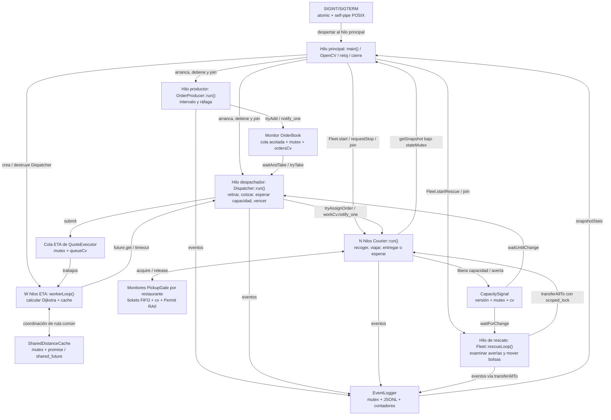

# EquipeGo — Simulación concurrente de delivery en Equipetrol

**Trabajo final de Concurrencia en C++17 · Zona Equipetrol, Santa Cruz de la Sierra, Bolivia**

EquipeGo simula una flota de repartidores independientes, un generador de pedidos por ráfagas, un despachador con cálculo concurrente de ETA, recursos de recogida limitados, averías y rescate de pedidos. La interfaz se dibuja con OpenCV sobre una imagen del mapa de Equipetrol. La corrección se contrasta con un registro JSONL y un resumen final.

> **Versión verificada de entrega:** código `0b51082` (rama `avance-12`); evidencias finales publicadas en `6dd487b`, sin cambios de código entre ambos commits. Se comprobó compilación desde clon limpio, 30/30 pruebas CTest y 12/12 ejecuciones con sanitizadores. `delivery_sim` acepta únicamente `config.json` y `--log RUTA`, y siempre abre OpenCV; `delivery_sim_bench` es un target auxiliar opcional para los experimentos.

## 1. Requisitos, dependencias y compilación (DP.0)

- **Estándar:** C++17, con `std::thread`, `std::mutex`, `std::condition_variable`, `std::future`, `std::promise` y otros componentes de la biblioteca estándar.
- **Construcción:** CMake 3.11 o superior, `make` y compilador compatible con C++17 (GCC 7+ o Clang equivalente).
- **Visualización:** OpenCV 4.1 o superior; se requiere un servidor gráfico operativo para ver la ventana (Linux/WSLg/X11).
- **JSON:** nlohmann/json, encontrado por CMake o descargado mediante `FetchContent` (alternativa configurada: v3.11.3).
- **Hilos:** `Threads::Threads` de CMake; no se utilizan OpenMP, TBB, Boost.Asio, Boost.Thread ni hilos nativos directos.

**Versiones registradas en el entorno de pruebas:** GCC 15.2.0 y OpenCV 4.10.0. La versión exacta de cada herramienta, los hashes de los binarios y los comandos de las 12 corridas instrumentadas finales constan en [`evidencias/dp12/auditoria_0b51082/`](evidencias/dp12/auditoria_0b51082/) (`tsan/versiones_herramientas.json`, `asan/versiones_herramientas.json` y `metadata.json`). El informe histórico también está en [`evidencias/dp11/`](evidencias/dp11/informe_final.md).

Desde la raíz del repositorio, el comando exigido por la rúbrica es:

```bash
mkdir build && cd build
cmake ..
make
./delivery_sim ../config/equipetrol.json
```

Para indicar otra ruta del registro de eventos:

```bash
./delivery_sim ../config/equipetrol.json --log run1.log
```

Para compilar con ThreadSanitizer, en un directorio de compilación independiente:

```bash
mkdir build-tsan && cd build-tsan
cmake -DENABLE_TSAN=ON ..
make
```

Las advertencias del compilador deben evaluarse con `-Wall -Wextra`, opciones ya aplicadas desde `CMakeLists.txt`. Las pruebas unitarias/integración disponibles se ejecutan con `ctest --output-on-failure` desde un directorio de compilación configurado.

## 2. Mapa, escenario y entrada (DP.1)

La configuración principal está en [`config/equipetrol.json`](config/equipetrol.json). Incluye **30 intersecciones, 42 segmentos de calle y 6 restaurantes**, y de esos segmentos **7 están marcados como unidireccionales**. El fondo configurado es [`data/equipetrol.png`](data/equipetrol.png), cuyo origen y correspondencia geográfica deben comprobarse visualmente contra OpenStreetMap antes de entregar.

Límites registrados (grados decimales):

| Norte | Sur | Oeste | Este |
|---:|---:|---:|---:|
| -17.75147 | -17.77655 | -63.21443 | -63.18718 |

La conversión latitud/longitud → píxel está en `src/config/ConfigLoader.cpp`, función `latLonToPixel`; `src/map/RoadNetwork.cpp` construye el grafo y calcula rutas mínimas por Dijkstra respetando `oneWay`. Los repartidores no planifican trayectos fuera de este grafo. Los restaurantes y nodos se dibujan en `src/visualization/MapViewer.cpp`.

**Atribución requerida por ODbL:** © OpenStreetMap contributors. El valor aparece en `config/equipetrol.json` y está visible en el panel OpenCV (`src/visualization/SimulationDashboard.cpp::drawFrame`), según la [captura de validación visual](evidencias/dp12/validacion_visual_20261013.png). La captura acredita legibilidad de la atribución y los marcadores, pero no demuestra por sí sola el origen técnico ni la correspondencia geográfica exacta de la imagen base; esa procedencia debe conservarse documentada.

La sección 5 define como interfaz pública la ruta al JSON y la bandera opcional `--log`. La validación de campos y referencias se encuentra en `src/config/ConfigLoader.cpp::loadAndValidateConfig`; los archivos inválidos deben generar un error legible en `stderr` y salir con código distinto de cero, sin comenzar la simulación. Los revisores pueden suministrar configuraciones propias; las muestras incluidas en este repositorio no reemplazan esa validación.

## 3. Arquitectura y diagrama completo de hilos (DP.12)

Se crean **1 hilo principal + 1 productor + 1 despachador + N repartidores + 1 coordinador de rescate + W trabajadores ETA**, donde `N = fleet.couriers` y `W = min(N, hardware_concurrency limitado a 8)` (con al menos un trabajador). El hilo principal ejecuta la interfaz OpenCV; **no** existe un hilo separado para la interfaz.



### 3.1 Inventario de hilos y destino

| Hilo | Creación real | Ciclo / trabajo | Coordinación | Cómo termina |
|---|---|---|---|---|
| Principal / GUI | `src/main.cpp::main` | `SimulationDashboard::frame`, recibe señales o vence `durationS`; crea, observa y finaliza componentes | `getSnapshot()`, `EventLogger::snapshotStats()`, señal atómica + self-pipe; `cv::waitKey` limita cuadros | Detiene en orden y llama `join` a los hilos creados; publica resumen |
| Productor (1) | `src/main.cpp`: `std::thread(&OrderProducer::run, &producer)` | `OrderProducer::run`: espera intervalo aleatorio, genera hasta `burstMax` y pone pedidos | `OrderBook::tryAdd`; `stopCv` del productor | `producer.requestStop(); producerThread.join()` |
| Despachador (1) | `src/main.cpp`: `std::thread(&Dispatcher::run, &dispatcher, std::ref(...))` | `DispatchLoop.cpp::run`: toma pedidos, compara ETA, asigna, vence plazos | `OrderBook::ordersCv`, `CapacitySignal::signalCv`, futures ETA, `Courier::tryAssignOrder` | `dispatcher.requestStop(orderBook); dispatcherThread.join()` |
| Repartidores (N) | `src/fleet/Fleet.cpp::start`: `threads.emplace_back(&Courier::run, courier.get())` | `Courier::run`: espera trabajo, prepara, ocupa cupo, viaja por segmentos y entrega | `workCv` + `stateMutex`; `PickupGate::acquire` FIFO | `fleet.requestStop(); fleet.join()` |
| Rescate (1) | `src/fleet/Fleet.cpp::startRescue`: `std::thread(&Fleet::rescueLoop, this)` | Examina motos averiadas; intenta transferir la bolsa completa a una moto con capacidad | `CapacitySignal::waitForChange`; `Courier::transferAllTo` con dos mutex | `rescueStopRequested`, señal y `rescueThread.join()` |
| Trabajadores ETA (W) | `src/dispatch/Dispatcher.cpp`: constructor de `QuoteExecutor` | `workerLoop`: saca trabajos ETA, calcula rutas y satisface `future` | `queueCv` de trabajos; `SharedDistanceCache::get` / `shared_future` | Destructor de `QuoteExecutor`: establece `stopping`, notifica y hace `join` |

### 3.2 Canales de comunicación, esperas y propiedad

| Canal o recurso | Emisor → receptor | Protección / evento que despierta | Archivo / lugar |
|---|---|---|---|
| Pedidos `OrderBook` | Productor → despachador | `bookMutex`; `ordersCv.notify_one`; predicado contra despertares espurios; cola acotada | `src/orders/OrderBook.cpp::tryAdd/waitAndTake` |
| Notificación de capacidad o avería | Repartidor / rescate / libro → despachador y rescate | `CapacitySignal`: generación + `signalMutex` + `signalCv`, `notifyChange`; despertar al parar | `src/fleet/CapacitySignal.hpp` |
| Bolsa de cada repartidor | Despachador y rescate → repartidor | `stateMutex`, `workCv.notify_one`; espera predicada en `Courier::run` | `src/fleet/Courier.cpp` |
| Plazas de restaurante | Repartidores → `PickupGate` | mutex, tickets FIFO, `cv.wait(predicado)`; liberación RAII | `src/restaurants/PickupGate.hpp` |
| Cotizaciones ETA | Despachador → trabajadores ETA → despachador | cola protegida, `queueCv`, `packaged_task<TimedQuote>`, `future::wait_until/get` y propagación de `exception_ptr` | `src/dispatch/Dispatcher.cpp` |
| Distancia compartida entre candidatos | Trabajadores ETA entre sí | mutex corto para mapa y `std::promise/std::shared_future` para completar una vez cada par de nodos | `src/dispatch/SharedDistanceCache.hpp::get` |
| Traspaso de toda la bolsa | Rescate → dos repartidores | `std::scoped_lock` sobre ambos `stateMutex`, verifica capacidad e IDs; notifica tras publicar la transferencia | `src/fleet/Courier.cpp::transferAllTo` |
| Bitácora y contadores | Productor, despacho y motos → registro → GUI/main | `EventLogger::logMutex`, instantánea bajo bloqueo | `src/core/Logger.cpp` |
| Solicitud de apagado | SO → principal → productor / dispatcher / flota / ETA | `sigaction`, `atomic<bool>` y self-pipe; `requestStop`, notificaciones, `join()` | `src/main.cpp::SignalStopController/main` |

### 3.3 Argumento escrito sobre ausencia de condiciones de carrera (carpeta 05)

La validez de cada acceso compartido depende de una regla explícita; **tener un mutex en algún lugar no basta**. A continuación se indica la regla de acceso del código:

| Estado compartido | Regla concreta que evita la carrera | Sin esa regla fallaría… |
|---|---|---|
| Cola, `inFlight`, límite y estado de cierre de `OrderBook` | Todos los accesos mutables pasan por `bookMutex`; la `condition_variable` espera con predicado protegido. | Lecturas corruptas, sobrecapacidad, pedidos perdidos y despertares perdidos. |
| Bolsas, pedido activo, posición por nodo y estado de cada moto | `stateMutex` protege modificaciones y `getSnapshot`; `transferAllTo` toma los **dos** mutex con `scoped_lock`. | Un mismo pedido podría observarse en dos bolsas, o la GUI leería estados incoherentes. |
| Plazas, tickets, contador de espera y bandera de cierre de restaurante | `PickupGate::mutex_`, FIFO `issuedTicket_/nextToEnter_`, CV; `Permit` libera en su destructor. | Exceder `pickupSlots`, violar orden de llegada o dejar una plaza bloqueada. |
| Cola y cierre de los workers ETA | `QuoteExecutor::queueMutex` + `queueCv`; los futures transfieren resultado/excepción. | Dos workers podrían modificar la cola simultáneamente o perder un trabajo. |
| Distancias ya calculadas o en cálculo | `SharedDistanceCache::mutex_` protege el mapa; cada par tiene un `shared_future`; el cálculo ocurre fuera del mutex. | Cálculos duplicados o escritura/lectura concurrente del mapa. |
| Eventos, archivo, contadores y tiempos por pedido | `EventLogger::logMutex` rodea las escrituras y las instantáneas. | Líneas JSONL intercaladas, contadores inconsistentes y tiempos incoherentes. |
| Cambios de disponibilidad y apagado | `CapacitySignal` usa mutex + generación; `Dispatcher`, rescate y señales usan atomics; el productor usa mutex para `stopRequested`. | Carreras de cierre, consumo innecesario de CPU o esperas que nunca terminan. |
| Configuración, mapa de calles y reloj tras iniciar | La configuración/red se comparten por referencia **solo de lectura** durante la ejecución; el reloj se inicia antes de crear los hilos. | Lecturas sobre datos mutados sin sincronización o tiempos inconsistentes. |
| Interfaz OpenCV | La GUI solo se dibuja y se cierra desde el hilo principal; recibe instantáneas copiadas. | Acceso concurrente inseguro a la ventana y mezcla de estados de distintas motos. |

Estas reglas están respaldadas por pruebas, pero no representan una prueba matemática universal: los experimentos instrumentados de DP.11 cubren los escenarios consignados en sus registros.

## 4. Mapa de conceptos obligatorio (carpetas 01 a 07)

Esta tabla **completa todas las filas obligatorias de la sección 10**. Cada referencia apunta a código funcional; la columna de estudio propio de la rúbrica no es evaluable ni obligatoria y por eso se omite.

| Carpeta | Concepto obligatorio (sección 10) | Archivo/lugar real, justificación y defecto sin él |
|:--:|---|---|
| **01** | Creación explícita de hilos y destino deliberado: unidos, nunca abandonados. | `src/main.cpp::main` crea productor y despachador, `src/fleet/Fleet.cpp::start/startRescue` crea N repartidores y el rescate, y `src/dispatch/Dispatcher.cpp::QuoteExecutor` crea W workers. `main` y los destructores solicitan parada y esperan mediante `join()`; sin ello se destruirían objetos mientras un hilo sigue usándolos o acabaría la aplicación con hilos activos. |
| **01** | Decisión dependiente del paralelismo disponible del hardware. | `src/dispatch/Dispatcher.cpp::Dispatcher` usa `std::thread::hardware_concurrency()` para dimensionar el pool ETA, acotado por la cantidad de repartidores y por ocho. Sin ese límite, flotas grandes podrían crear demasiados trabajadores para el equipo y perder rendimiento en cambios de contexto. |
| **02** | Datos entregados por valor, referencia y movimiento, en el caso correcto. | **Valor:** `QuoteExecutor::submit` captura `startNode`, `courierId` e índices por valor en el trabajo que consumirá otro hilo; también se pasa por valor el puntero no propietario `courier.get()` al crear `std::thread` en `Fleet::start`. **Referencia:** `main` usa `std::ref(orderBook)`, `std::ref(logger)` y `std::ref(clock)` para el hilo despachador. **Movimiento:** `OrderProducer` inserta con `std::move(order)` en `OrderBook::tryAdd`; `Courier::run` y `transferAllTo` mueven pedidos entre contenedores. Referencias a temporales colgarían; copiar pedidos vulneraría su propiedad única; no moverlos haría imposible transferir un `Order` no copiable. |
| **02** | Pedidos transferidos por movimiento, con un solo propietario. | `src/orders/Order.hpp` elimina constructor y asignación de copia, pero habilita operaciones `noexcept` de movimiento. `OrderBook::tryAdd/waitAndTake` y `Courier::tryAssignOrder/transferAllTo` mueven el pedido entre el libro y las bolsas bajo sincronización; sin esta disciplina podría duplicarse o procesarse desde varios dueños. |
| **03** | Funciones miembro ejecutadas por hilos y contenedores de hilos. | `src/fleet/Fleet.cpp::start` crea `threads.emplace_back(&Courier::run, courier.get())` y mantiene `std::vector<std::thread>`. `main.cpp` invoca `Dispatcher::run` y `OrderProducer::run` desde hilos; sin agrupar y unir los hilos, no se podría supervisar el ciclo de vida de toda la flota. |
| **03** | Propiedad compartida que garantiza tiempos de vida; ningún puntero crudo con propiedad. | `Fleet` usa `std::shared_ptr<CapacitySignal>` y `std::shared_ptr<RestaurantManager>`; este mantiene un `shared_ptr<PickupGate>` por restaurante (`src/restaurants/RestaurantManager.hpp`). `Courier` conserva copias de esos punteros; `std::unique_ptr<Courier>` da propiedad exclusiva a Fleet. Los punteros crudos (`courier.get()`, `eventLogger`) son observadores, no propietarios, con vida coordinada por `join()`. Sin esas garantías podría usarse un monitor destruido. |
| **04** | Tareas con resultado mediante future y política de lanzamiento declarada. | `src/dispatch/Dispatcher.cpp::QuoteExecutor::submit/workerLoop` usa `std::packaged_task<TimedQuote()>` y `std::future<TimedQuote>`, con política **explícita de planificación en pool fijo**: los trabajos se encolan y los W workers los ejecutan sin lanzar un hilo por cotización. Si el despacho ejecutase secuencialmente Dijkstra, excedería más fácilmente `quoteTimeoutMs` y bloquearía el despachador. **Nota de interpretación:** no se usa literalmente `std::async(std::launch::async, ...)`; confirmar con el docente si exige esa sintaxis y no acepta la política explícita de pool. |
| **04** | Canal de un solo uso promise/future entre dos hilos. | `src/dispatch/SharedDistanceCache.hpp::SharedDistanceCache::get`: el hilo dueño publica `std::promise<double>` y los interesados esperan su `std::shared_future<double>`. Se completa una sola vez por par origen/destino, compartiendo incluso excepciones; sin el canal, habría duplicación de Dijkstra o espera activa. |
| **04** | Espera limitada y excepciones propagadas entre hilos. | `src/dispatch/Dispatcher.cpp::quoteCandidates` usa `future.wait_until(deadline)` y `TimedQuote::error` (`std::exception_ptr`); el despacho reconoce `quoteTimeout` e informa errores de cotización. Sin deadline podría bloquearse por un cálculo lento, y sin propagación un fallo aislado terminaría el proceso o sería ocultado. |
| **05** | Argumento escrito por cada objeto compartido sobre ausencia de carrera. | Ver la tabla de la sección **3.3**: cubre libro de pedidos, motos/bolsas, recursos de restaurantes, cola/caché ETA, logger, señal, configuración, reloj y GUI. Cada objeto tiene una regla de bloqueo, atomicidad, inmutabilidad o propiedad de hilo identificable; sin ella existirían lecturas y escrituras sin relación de sincronización. |
| **05** | Tipo seguro de copiar o mover gracias a funciones miembro especiales correctas. | `src/restaurants/PickupGate.hpp::Permit` prohíbe copia, permite movimiento `noexcept` con `std::exchange` y libera el cupo en su destructor; esto es RAII de un recurso exclusivo. `src/orders/Order.hpp` también elimina copias y define movimientos `noexcept`. Si un permiso pudiera copiarse, su destructor podría liberar la misma plaza dos veces. |
| **06** | Exclusión mutua exclusivamente con bloqueos de ámbito, secciones críticas cortas. | `src/orders/OrderBook.cpp` usa `std::lock_guard`; `src/fleet/Courier.cpp` combina `std::lock_guard` y `std::unique_lock` para soltar mutex durante esperas largas; `src/dispatch/Dispatcher.cpp::QuoteExecutor` extrae el trabajo bajo bloqueo y lo ejecuta fuera de él. Sin ámbito RAII una excepción podría dejar un mutex adquirido o serializar todo el sistema. |
| **06** | Operación con dos bloqueos simultáneos y por qué no se interbloquea. | `src/fleet/Courier.cpp::transferAllTo` usa `std::scoped_lock(stateMutex, recipient.stateMutex)` para tomar los dos mutex de origen y destino sin imponer órdenes opuestos. La transferencia se publica bajo ambos bloqueos; con adquisiciones secuenciales de orden variable dos rescates simultáneos podrían formar un ciclo de espera. |
| **07** | Monitores: datos compartidos inaccesibles sin su mutex. | `src/orders/OrderBook.hpp/.cpp` encapsula cola/estado/capacidad bajo `bookMutex`; `src/restaurants/PickupGate.hpp` encapsula tickets, plazas y CV; `src/fleet/Courier.hpp/.cpp` encapsula bolsa y estado con `stateMutex`. Acceder sin esos monitores permitiría exceder capacidad o ver estados parcialmente actualizados. |
| **07** | Espera predicada, despertar por otro hilo, tolerancia a espurios y despertar final. | `OrderBook::waitAndTake` usa `ordersCv.wait(lock, predicado)`, `Courier::run` espera en `workCv`, `PickupGate::acquire` en `cv_`, `CapacitySignal::waitForChange` comprueba generación o parada. `requestStop()` y `notify_all()` despiertan a los bloqueados durante el cierre; sin predicados los despertares espurios consumirían trabajo inexistente o el apagado quedaría colgado. |

## 5. Funcionamiento y observabilidad (DP.2–DP.9)

1. `src/orders/OrderGenerator.cpp` usa distribuciones aleatorias y una semilla configurable. `OrderProducer::run` crea pedidos y ráfagas y escribe `orderCreated` antes de enviarlos a `OrderBook`. Los rechazos `queueFull` y `unreachable` se registran explícitamente.
2. `src/dispatch/DispatchLoop.cpp::run` extrae pedidos, calcula cotizaciones concurrentes, respeta `quoteTimeoutMs` en tiempo real y vence los pedidos por `acceptTimeoutMs` simulado. Una asignación confirmada se escribe como `orderAssigned`.
3. `src/fleet/Courier.cpp::run` realiza el trabajo del repartidor y usa `PickupGate` para imponer `pickupSlots` y tickets FIFO. `travelTo` recorre segmentos de `RoadNetwork`; las averías provocan notificaciones a `Fleet::rescueLoop`, y `transferAllTo` realiza rescates completos con dos mutex.
4. `src/core/Logger.cpp::logStart` imprime exactamente `Simulation has started...` al estar listo. Los eventos permitidos son `orderCreated`, `orderAssigned`, `pickupStarted`, `orderPickedUp`, `orderDelivered`, `orderRejected`, `courierBreakdown`, `orderReassigned` y `simulationStopping`. Cada JSONL incluye `t` en milisegundos simulados y campos según el evento.
5. `src/main.cpp::main` detiene productor, despachador y flota, une los hilos, clasifica pedidos pendientes, registra `simulationStopping`, audita el archivo y escribe como última línea un JSON con `created`, `delivered`, `rejected`, `pending`, `reassigned`, `breakdowns`, `avgDeliveryMs`, `maxDeliveryMs` y `deliveredPerCourier`.

**Invariantes comprobables:** `created = delivered + rejected + pending`; las entregas por repartidor suman `delivered`; ningún pedido puede terminar en dos estados diferentes. Las pruebas automatizadas revisan además el registro completo y el cierre con señales.

**Límite de la visualización actual:** `SimulationDashboard::takeSamples` interpola la posición estimada a partir del nodo confirmado y un temporizador local. Para aprobar estrictamente la sección 2, se debe probar durante carga que este avance representa fielmente la posición física del repartidor en cada instante, incluyendo preparación, demoras, averías y escalas diferentes, sin saltos espurios. El panel actual también debe verificarse con configuraciones de 64 repartidores.

## 6. Experimentos propios y cambio de diseño (DP.10)

Los experimentos de flota y demanda se pueden consultar en [`evidencias/dp8_6/`](evidencias/dp8_6/) y los datos crudos de la comparación en [`evidencias/dp10/`](evidencias/dp10/). Script: `benchmarks/dp10_eta_before_after.py`.

**Experimento antes/después:** caché concurrente en `SharedDistanceCache.hpp` para compartir la distancia restaurante → cliente entre las cotizaciones de diferentes motos. Las condiciones se mantuvieron iguales salvo por el algoritmo del dispatcher: flotas de 8, 32 y 64 motos; 900 segundos simulados; `timeScale=60`; tres repeticiones por versión y cantidad de motos; misma configuración generadora y semilla.

| Motos | CPU promedio antes (s) | CPU promedio después (s) | Cambio aproximado en CPU | Entregados antes → después (promedio) |
|---:|---:|---:|---:|---:|
| 8 | 0.83 | 0.79 | −5.19 % | 17 → 17 |
| 32 | 1.06 | 1.14 | +7.36 % | 58 → 58 |
| 64 | 1.99 | 1.61 | −19.16 % | 93.3 → 96.7 |

**Interpretación:** la mejora medida más clara apareció con 64 motos, donde se consumió aproximadamente 19.16 % menos CPU total. Con 32 motos el coste aumentó: el efecto no es uniforme ni garantiza una mejora universal. La variabilidad de la planificación afecta las entregas y las latencias. El P95 de asignación del script incluye el tiempo que un pedido espera por capacidad y **no** es una medición aislada del algoritmo ETA.

**Qué cambió:** `src/dispatch/Dispatcher.cpp` dejó de calcular la misma ruta restaurante → cliente una vez por candidato y ahora consulta `SharedDistanceCache`, cuyo acceso está sincronizado con mutex + promise/shared_future. **Qué permaneció igual:** demanda, red, semilla, capacidades, tiempos y límite de workers en cada comparación. Las carpetas `evidencias/dp10/antes/` y `evidencias/dp10/despues/` contienen el JSON de configuración, JSONL, stdout, stderr, CSV y resultados individuales de las 18 corridas.

## 7. Análisis dinámico de memoria y carreras (DP.11)

**Campaña histórica (anterior a DP.12.8):** [`evidencias/dp11/informe_final.md`](evidencias/dp11/informe_final.md). Se realizaron **12 ejecuciones instrumentadas**: seis con ThreadSanitizer y seis con AddressSanitizer + LeakSanitizer + UndefinedBehaviorSanitizer. Todas incluyeron pedidos en ráfaga, averías y apagado por SIGINT o SIGTERM. Las copias de configuración usaron `bagCapacity=1`, `meanIntervalMs=5000`, `burstMax=12`, `maxPending=20` y `breakdownProbability=1.0`.

| Herramientas | Repeticiones | Reportes en los escenarios ensayados | Evidencias |
|---|---:|---|---|
| TSAN (carreras de datos) | 6/6 satisfactorias | Sin hallazgos | `evidencias/dp11/tsan_inicial/`, `tsan_repeticion/` |
| ASAN + LSAN + UBSAN (memoria y comportamiento indefinido) | 6/6 satisfactorias | Sin hallazgos | `evidencias/dp11/asan_inicial/`, `asan_repeticion/` |

En la **campaña histórica**, esas 12 ejecuciones acumularon **5.430 pedidos creados y 96 averías**; todas salieron con código 0, respetaron `simulationStopping` único y terminaron en **0.518 s o menos** desde la señal. No fueron necesarias correcciones de memoria/concurrencia en DP.11 porque no se encontraron reportes; se repitieron las pruebas y volvieron a pasar. **No encontrar defectos no demuestra ausencia de todos los defectos posibles.**

**Comandos usados en la campaña histórica**, además de las versiones y variables de entorno consignadas en los registros originales (para la versión final, usar `delivery_sim_bench`, como se describe en la sección 8.2):

```bash
cmake -S . -B ~/build-equipego-tsan -DENABLE_TSAN=ON
cmake --build ~/build-equipego-tsan --target delivery_sim -j4
python3 benchmarks/dp11_dynamic_analysis.py --sanitizer tsan \
  --binary ~/build-equipego-tsan/delivery_sim --max-wait 120 --repeats 2

cmake -S . -B ~/build-equipego-asan -DCMAKE_BUILD_TYPE=Debug \
  '-DCMAKE_CXX_FLAGS=-fsanitize=address,undefined -fno-omit-frame-pointer -g -O1' \
  '-DCMAKE_EXE_LINKER_FLAGS=-fsanitize=address,undefined'
cmake --build ~/build-equipego-asan --target delivery_sim -j4
python3 benchmarks/dp11_dynamic_analysis.py --sanitizer asan \
  --binary ~/build-equipego-asan/delivery_sim --max-wait 120 --repeats 2
python3 benchmarks/dp11_finalize_report.py
```

Cada carpeta contiene versiones, configuración de cada prueba, `stdout.txt`, `stderr.txt`, `events.jsonl` y los comandos precisos en `metadata.json`. Las pruebas son independientes de este README y pueden reproducirse desde el código fuente.

## 8. Evidencias, tests y estructura del repositorio

| Ruta | Propósito |
|---|---|
| `src/` | Código fuente del simulador: ciudad, despacho, motos, restaurantes, pedidos, observabilidad y GUI |
| `config/equipetrol.json` | Escenario por defecto; admite validación de JSON según sección 5 |
| `data/equipetrol.png` | Imagen de fondo requerida de Equipetrol |
| `tests/` | Pruebas de logger, callbacks, incidentes, GUI y cierre; `test_shared_distance_cache.cpp` cubre 32 hilos concurrentes |
| `benchmarks/dp8_6_scalability.py` y herramientas DP.10/DP.11 | Experimentos reproducibles sin editar la configuración original |
| `evidencias/dp10/` | Tabla antes/después, configuraciones, JSONL y resúmenes crudos |
| `evidencias/dp11/` | 12 ejecuciones instrumentadas y archivos originales sin editar |

## 8.1 Interfaz pública y modo de pruebas (DP.12.8)

Desde el directorio de compilación, **la interfaz oficial** es:

```bash
./delivery_sim ../config/equipetrol.json
./delivery_sim ../config/equipetrol.json --log run1.log
```

Este ejecutable abre OpenCV obligatoriamente y rechaza `--headless`, `--gui`, `--scale` y `--duration`. Si no hay pantalla, informa un error en lugar de ejecutar oculto.

**Solo para diagnósticos**, activar el segundo target con `cmake -S . -B build-bench -DEQUIPEGO_BUILD_BENCHMARK=ON` y compilar. Por defecto solo se compila la aplicación oficial. El auxiliar `delivery_sim_bench` se ejecuta así:

```bash
./delivery_sim_bench ../config/equipetrol.json --headless --scale 60 --duration 300 --log ensayo.jsonl
```

Los informes existentes conservan sus comandos originales y SHA de ejecutables. Para reproducir un escenario con banderas de diagnóstico después de DP.12.8, apuntar `--binary` o el script a `delivery_sim_bench`.

En OpenCV, las motos muestran color interior según estado (gris libre, naranja hacia restaurante, verde entrega, rojo avería); rombos rojos marcan destinos de los pedidos activos. Se conserva la atribución OSM.

## 8.2 Auditoría técnica definitiva (DP.12.9)

**Referencia inmutable del código verificado:** commit `0b51082` de `avance-12`. El commit posterior `6dd487b` incorporó exclusivamente los archivos de evidencia de esa auditoría. Las pruebas anteriores en `evidencias/dp11/` siguen siendo válidas como antecedentes, pero los resultados de la versión de entrega se encuentran en [`evidencias/dp12/auditoria_0b51082/`](evidencias/dp12/auditoria_0b51082/).

| Validación de la versión final | Resultado | Evidencia |
|---|---:|---|
| Clon limpio + compilación oficial Release | OK; `delivery_sim_bench` ausente en el build oficial | `evidencias/dp12/auditoria_0b51082/ctest/release.txt` (CTest) y registro de compilación de la auditoría |
| CTest Release | 10/10 | `evidencias/dp12/auditoria_0b51082/ctest/release.txt` |
| CTest ThreadSanitizer | 10/10 | `evidencias/dp12/auditoria_0b51082/ctest/tsan.txt` |
| CTest AddressSanitizer + UndefinedBehaviorSanitizer | 10/10 | `evidencias/dp12/auditoria_0b51082/ctest/asan.txt` |
| Seis ejecuciones TSAN (SIGINT/SIGTERM) | 6/6 | `evidencias/dp12/auditoria_0b51082/tsan/` |
| Seis ejecuciones ASAN/UBSAN (SIGINT/SIGTERM) | 6/6 | `evidencias/dp12/auditoria_0b51082/asan/` |
| Pruebas adversarias (invalidaciones, carga, señales) | 22/22 | `evidencias/dp12/adversarial/` |
| Validación visual, ocho motos y destinos | Captura inspeccionada | [`evidencias/dp12/validacion_visual_20261013.png`](evidencias/dp12/validacion_visual_20261013.png) |

En las **12 ejecuciones instrumentadas definitivas** se registraron **5.878 pedidos creados**, **96 averías**, ráfagas máximas de 12 pedidos y un tiempo de cierre máximo observado de **0,265 segundos**. Las 12 salieron con estado 0; la herramienta de auditoría no identificó hallazgos de TSAN, ASAN/LSAN ni UBSAN en esas corridas. Los directorios `tsan/` y `asan/` conservan versiones, configuración, `metadata.json`, eventos, `stdout.txt`, `stderr.txt` y el informe. *La ausencia de reportes en las corridas no prueba la ausencia de todos los posibles defectos.*

Para repetir el análisis dinámico final tras compilar con instrumentos, activar expresamente `-DEQUIPEGO_BUILD_BENCHMARK=ON` y utilizar el binario auxiliar:

```bash
python3 benchmarks/dp11_dynamic_analysis.py \
  --sanitizer tsan --binary /ruta/build-tsan/delivery_sim_bench --repeats 3
python3 benchmarks/dp11_dynamic_analysis.py \
  --sanitizer asan --binary /ruta/build-asan/delivery_sim_bench --repeats 3
```

El ejecutable público de entrega (`delivery_sim`) permanece separado: no admite `--headless`, `--gui`, `--scale` ni `--duration`. Su apertura gráfica y el contrato de eventos se comprobaron con `tests/test_dp12_8_contract.py --run`; la captura incluida muestra el mapa, ocho motos, estados, destinos activos y la atribución visible de OpenStreetMap.

## 9. Lista de verificación antes de entregar (obligatoria)

- [x] Clon limpio del commit `0b51082`: compilación Release y CTest 10/10; compilación ThreadSanitizer y CTest 10/10; compilación ASAN/UBSAN y CTest 10/10.
- [x] 12/12 ejecuciones instrumentadas sobre `0b51082`, con registros crudos sin editar (`evidencias/dp12/auditoria_0b51082/`).
- [x] 22/22 pruebas adversarias (12 configuraciones inválidas, siete casos de carga, tres apagados por señales), bajo la versión previa con la misma lógica de simulación (`evidencias/dp12/adversarial/`).
- [x] Interfaz oficial que abre siempre OpenCV, y ejecutable `delivery_sim_bench` habilitado solo cuando se solicita explícitamente; pruebas de contrato correctas.
- [x] Inspección visual de ocho motos, estados por color, destinos activos y atribución de OpenStreetMap; [captura adjunta](evidencias/dp12/validacion_visual_20261013.png). Una captura estática no certifica por sí sola la fluidez de toda la animación.
- [x] Progreso real de las motos en segmentos del grafo y congelación ante averías validados con `test_dp12_motion` y CTest.
- [x] CPU ociosa estable medida para 8 y 64 motos; diferencia entre costo del visor y costo de hilos de repartidores documentada en `evidencias/dp12/cpu_ociosa/`.
- [ ] Verificación visual humana del **escenario de 64 motos** bajo ejecución prolongada: el escenario adversario superó la prueba automatizada, pero la captura aportada representa ocho motos.
- [ ] Conservar referencia verificable del **origen exacto y exportación** de `data/equipetrol.png` y comprobar sobre el mapa real la cobertura de los anillos y avenida San Martín. La captura visible no documenta toda esa procedencia.
- [ ] Confirmar con el docente, si fuese necesario, si la política de planificación explícita de tareas del pool `QuoteExecutor` satisface la fila sobre futuros y lanzamiento. La rúbrica menciona una política de lanzamiento declarada, no exige literalmente `std::launch::async`.

**Estado:** las evidencias de compilación, contrato, estrés, pruebas dinámicas y GUI principal están registradas. Los tres puntos sin marcar son revisiones externas o visuales; no se declaran aprobados automáticamente.


---

**Mapa/datos:** © OpenStreetMap contributors. Datos de OpenStreetMap disponibles bajo [Open Database License (ODbL)](https://www.openstreetmap.org/copyright).
