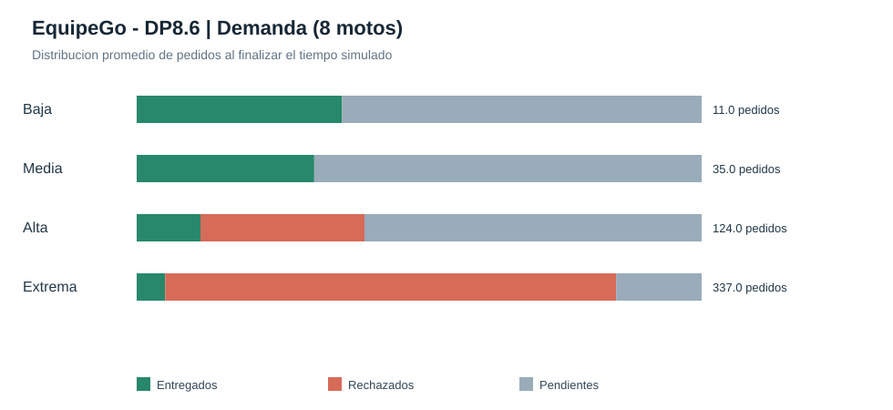

# EquipeGo | DP8.6 - Escenarios de demanda

## Condiciones del experimento

- Flota fija: **8 motos**.
- Tiempo: **900 segundos simulados**.
- Escala: **60.0x**.
- Repeticiones por escenario: **3**.
- Misma semilla, mapa, restaurantes, velocidad, cola e incidencias en todas las pruebas.
- Solo cambian `orders.meanIntervalMs` y `orders.burstMax` en copias del JSON.
- `pendientes` significa sin terminar al corte; no implica pedidos perdidos.

| Demanda | Intervalo medio (ms) | Rafaga max. | Creados | Entregados | Rechazados | Pendientes | % Entrega | Rechazo por cola |
| :--- | ---: | ---: | ---: | ---: | ---: | ---: | ---: | ---: |
| baja | 120000 | 1 | 11.0 | 4.0 | 0.0 | 7.0 | 36.4% | 0.0 |
| media | 45000 | 2 | 35.0 | 11.0 | 0.0 | 24.0 | 31.4% | 0.0 |
| alta | 20000 | 4 | 124.0 | 14.0 | 36.0 | 74.0 | 11.3% | 30.0 |
| extrema | 20000 | 12 | 337.0 | 17.0 | 269.0 | 51.0 | 5.0% | 233.0 |

## Interpretacion

- Compara `queue_full_mean` para detectar saturacion de la cola.
- La cantidad de pedidos creados varia a proposito entre escenarios: no comparar solamente cantidades absolutas.
- Considera % entrega, % rechazo y entregas por hora simulada junto con el volumen creado.
- La fraccion entregada al corte no representa necesariamente el porcentaje final si se dejara drenar la cola.
- Este ensayo caracteriza la demanda y capacidad; NO mide el speedup del calculo ETA en CPU.
- La semilla fija favorece la reproducibilidad, pero no garantiza determinismo de todos los interleavings concurrentes.

