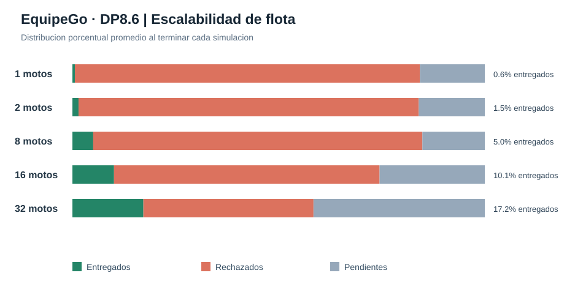

# EquipeGo — DP8.6 | Escalabilidad de flota

- Duracion por ejecucion: **900 s simulados**.
- Escala de tiempo: **60.0x**.
- Repeticiones por flota: **3**.
- Se mantiene el mismo generador, semilla, restaurantes y probabilidad de averias.
- Cada escenario termina al vencer la duracion (no espera vaciar la cola).

| Motos | Creados | Entregados | Rechazados | Pendientes | Entrega % | Rechazo % | Duracion real (s) |
| ---: | ---: | ---: | ---: | ---: | ---: | ---: | ---: |
| 1 | 337.0 | 2.0 | 282.0 | 53.0 | 0.6% | 83.7% | 15.80 |
| 2 | 337.0 | 5.0 | 278.0 | 54.0 | 1.5% | 82.5% | 15.35 |
| 8 | 337.0 | 17.0 | 269.0 | 51.0 | 5.0% | 79.8% | 15.22 |
| 16 | 337.0 | 34.0 | 217.0 | 86.0 | 10.1% | 64.4% | 15.18 |
| 32 | 337.0 | 58.0 | 139.0 | 140.0 | 17.2% | 41.2% | 15.18 |

## Interpretacion

- `Entregados / creados` mide la fraccion completada ANTES del corte, no la tasa final de exito de la cola.
- `Pendientes` incluye trabajos en proceso al acabar la duracion; no equivale a pedidos perdidos.
- Una mayor cantidad de motos no prueba por si sola speedup paralelo: para eso medir ETA con 1, 2, 4 y 8 workers.
- Los porcentajes son promedios de cada repeticion; revisa `resultados_individuales.csv` para la variabilidad.

